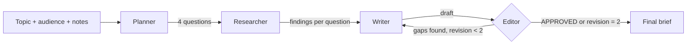

# BriefForge


**Give it a topic. Get a structured research brief — planned, drafted, and edited by a multi-agent graph.**

BriefForge runs four roles in sequence: a planner breaks the topic into questions, a researcher answers each one, a writer assembles a markdown brief, and an editor either approves it or sends it back with concrete gaps. The loop is bounded, so it always terminates.

Built by **Ariba Shakil**.

---

## Why this exists

A single "write me a brief" prompt produces generic filler. Separating the work into roles gives each step a narrow job: planning forces coverage, research forces specificity, and the editor catches a draft that ignored its own findings. The critique loop is what turns a first draft into something usable.

## Features

- **Four-role LangGraph pipeline** — planner → researcher → writer → editor
- **Bounded revision loop** — at most two drafts, then it ships
- **Structured brief output** — executive summary, key findings, risks, next steps
- **Optional source notes** — paste context and every agent is told to ground on it
- **Fail-safe JSON parsing** — tolerates fences and prose around the planner's array
- **OpenAI-compatible** — OpenAI, OpenRouter, Groq, or a local vLLM endpoint

## Architecture



State is a single typed dictionary (`BriefState`) carried through the graph, so every node receives the full context and returns only the fields it changes.

| Layer | Choice |
|---|---|
| API | FastAPI |
| Orchestration | LangGraph `StateGraph` |
| Model calls | LangChain (LCEL) |
| LLM | `gpt-4o-mini` (configurable) |

## Quickstart

```bash
cd briefforge
python -m venv .venv && source .venv/bin/activate
pip install -r requirements.txt
cp .env.example .env        # add your key
uvicorn app.main:app --reload
```

### Generate a brief

```bash
curl -X POST http://127.0.0.1:8000/brief \
  -H "Content-Type: application/json" \
  -d '{
    "topic": "Adopting on-device AI for a mobile banking app",
    "audience": "VP of Engineering",
    "notes": "We ship to 4M Android users; most devices are mid-range; latency budget is 300ms."
  }'
```

```json
{
  "topic": "Adopting on-device AI for a mobile banking app",
  "questions": [
    "Which on-device use cases deliver the highest user value?",
    "What device coverage can we realistically support?",
    "What are the privacy and compliance implications?",
    "What is the rollout and fallback strategy?"
  ],
  "revisions": 1,
  "critique": "APPROVED",
  "brief": "## Executive summary\nOn-device inference is viable for..."
}
```

### Web UI

```bash
# terminal 1
uvicorn app.main:app --reload --port 8002

# terminal 2
streamlit run streamlit_app.py
```

The UI opens at `http://localhost:8501` with a topic form and tabs for the brief, the research plan, and the editor's notes. Override the backend with `BRIEFFORGE_API_URL`.

### Tests

```bash
pytest
```

Tests use `FakeListChatModel`, so the full graph — including the revision loop — runs offline with no API key.

## API

| Method | Path | Purpose |
|---|---|---|
| `GET` | `/health` | Status and pipeline description |
| `POST` | `/brief` | Generate a brief from a topic |

## Design decisions

- **Graph over one mega-prompt.** Each node has one responsibility and one prompt, which makes failures easy to isolate.
- **Hard revision cap.** Two critiques maximum; the loop cannot run away on a stubborn editor.
- **Explicit approval token.** The editor must start its reply with `APPROVED`; anything else is treated as feedback.
- **Notes are optional, not required.** The service works from model knowledge but clearly labels assumptions when no sources are supplied.

## What I would add next

- Web search or a retriever node for real citations
- Token and cost accounting per node
- Parallel research fan-out with `Send`
- Streaming the brief as each section completes
- A small evaluation set scoring coverage and factual grounding

## License

MIT © 2026 Ariba Shakil
